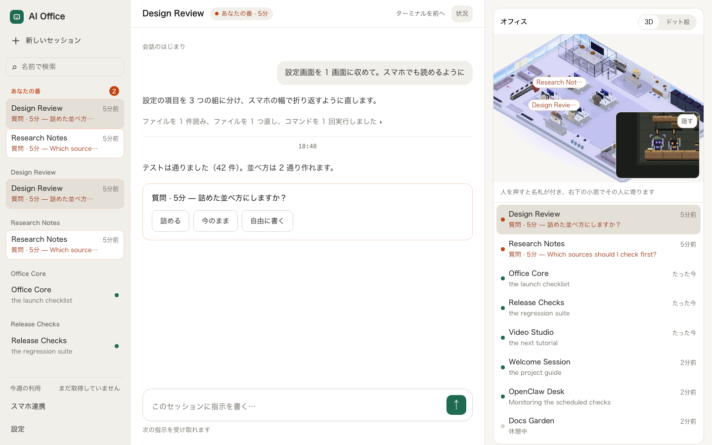

# AI Office

<!--version-->v3.0.0<!--/version--> · macOS 専用 · MIT · アカウント不要・テレメトリ無し・作者のサーバーは存在しません

**AI オフィス 3.0 は、Mac の Claude Code・Codex CLI・OpenClaw のセッションと、あなたが動かす Bot を 1 つの部屋にまとめる道具です。動いているものを見て、あなた待ちに Mac からもスマホからも答え、1 日の仕事を一目で把握できます。**



```bash
git clone https://github.com/senao-routine/ai-office.git && cd ai-office
bash setup.sh --demo   # まず見るだけ：何も入れない・Ctrl-C で何も残らない
bash setup.sh          # 自分のセッションを部屋に出す
```

自分のセッションが映るのは、**この後に開いた** Claude Code のセッションからです（配線は新しいセッションから効きます）。スマホからも答えるときは `bash relay/setup.sh` を 1 回だけ。中継はあなた自身の Cloudflare の無料枠に置きます（[スマホ](#スマホ)）。

## フィードバック

版の表示は画面の足元に常に出ていて、その横の **［フィードバック］** から報告の窓口（GitHub の issue）と、診断情報の画面を開けます。診断に入るのは数と状態だけで、**会話の本文・フォルダ名・プロジェクト名は入りません**。内容を見てから自分でコピーします。同じ画面に、3.0 の β を試し、名前の掲載を承諾してくれたメンバーへの謝辞（Special Thanks）も並びます。

## 何のための道具か

セッションを**動かす**道具は本家が出しています（**Agent View** が並列セッションを 1 か所に並べ、**Remote Control** がスマホから答える）。どちらも良い道具で、AI Office はその置き換えではありません。こちらが受け持つのは残り半分 — **1 日の仕事を、複数のベンダーをまたいで、一目で見る**ことです。

- **全部のベンダーが同じ部屋に居る。** Claude Code（対話・バックグラウンド）、Codex CLI、つないだ OpenClaw が 1 つの部屋にロボットとして出ます。1 セッション＝1 体、`/rename` がそのまま表示名に（同じフォルダで並走するセッションも区別できる・プロジェクト単位の集約は任意）。
- **枠とお金が 1 枚で見える。** サブスクの枠と従量の残高を並べて出します（いまは 7 プロバイダ・接続テストと「＋ つなぐ」・上限が無いものは「上限が設定されていません」と書く＝嘘の % を出さない）。
- **この Mac から出ない。** アカウントもテレメトリも、こちらのサーバーもありません。外へ出るのは**自分で置いた**中継と、**自分の鍵を入れた**プロバイダへの通信だけです（「この Mac から何が出るか」）。
- **置いておく価値のある部屋。** 生成した什器、時刻で変わる光、歩く・座る・打鍵する・呼ぶときに手を挙げるロボット——コックピットのドット絵でも、3D のオフィスでも。

## 1 つのオフィス、4 つの見え方

Mac の既定は明るい 3 列の画面（`?ui=app`）です。左は「あなたの番」と、プロジェクトごとに並んだ全部のセッション（名前で絞り込めます）。中央は選んだセッションの会話を Claude Code のアプリと同じ形で——あなたの指示・返事・走らせた道具は 1 行に畳んで開けるように・待っているときは質問と実際の選択肢をボタンで。押すか指示を書けば、そのセッションの次の区切りで届きます。右はオフィスそのもの（3D かドット絵・選んだ人に寄る小窓つき）と、そのセッションがいまやっていること・やること・変えたファイルです。常駐の Bot も同じように扱えて、選ぶと中央にその Bot の記録（出勤・報告・相談とあなたの答え）が出ます。

⚙ 設定の「画面」から、同じオフィスのほかの 3 つの見え方に切り替えられます。選択はブラウザごとに記憶され、回答キュー・シート・定型文・雇う・ゲージはどれも同じコードです。

- **コックピット**（`?ui=cockpit`）— ターミナル×ドット絵のオフィスに、本物の端末・台帳・あなた待ちの一覧が 1 画面に乗ります。端末には実際に打てて ^C も効き、ウィンドウの大きさに合わせて伸び縮みし、再読み込みしても同じセッションへ戻れます。**「＋ 端末」**で、選んだプロジェクトのフォルダに Claude Code・Codex・ただのシェルの新しいセッションを起こせます。窓は入れ替え・境目のドラッグができ、端末は 4 つまで分割できます。
- **3D のオフィス**（`?ui=iso`）— この企画が始まったときの、昼光の北欧インテリア——オーク床・白壁・植物と、歩く・座る・打鍵する・呼ぶときに手を挙げるリグ付きの陶器ロボです。丸頭とアンテナ 1 本が Claude、角丸四角の頭とアンテナ 2 本が Codex、ロブスターのシルエットが OpenClaw、天面にランプの乗った箱の頭があなたの Bot です。
- **台帳**（`?ui=pixel`）— 1 プロジェクト 1 行・行の高さ 30px にして、20 プロジェクト・40 セッションを 1 画面に収めます。❗が出た行は配下のセッションを開いて最上段へ動き、数字キーでそのまま答えられ、証拠列には実際に仕事が片付いたかが出ます（後述）。表の上の側面のドット絵の帯は、画像ファイルではなくソースの中の文字グリッドなので、コードと同じように差分が読めます。

## セッションの扱い

- **回答キューと状況シート** — 質問の実際の選択肢、数字キーでの回答、いま/次/完了タスク、最近の活動、返信チップ、自由入力。
- **Codex CLI 対応** — `~/.codex` の SQLite を読み取り専用で参照し、`codex queue` で指示を配達。セッション用アダプタは会話本文の列を読みません。配達には `queue` 対応の Codex CLI が必要で、失敗時は失敗として表示します。
- **雇う** — 登録済みプロジェクトと仕事を選び、「別ブランチで隔離」を切り替えて起動。`POST /api/hire` から `claude --bg` を実行し、隔離時は worktree を使います。Codex の選択肢は `open -a Terminal` をコピーし、手元で Terminal を開いて Codex を起動する導線です（コックピットの「＋ 端末」なら、画面の中で直接打てるセッションも起こせます）。
- **今日の 1 枚** — 左の列の足元のボタンから、部屋のドット絵と今日の数（セッション・答えた質問・commit・動いた時間・道具の実行）を 1200×675 の PNG 1 枚に。名前は入りません（数は名前を持たず、部屋は文字を描かない）＝そのまま SNS に出せます。
- **留守中ダイジェストと20秒リプレイ** — 返答待ち・完了・進行中をまとめ、記録した時間軸を20秒に圧縮して再現。端末の画面や会話本文の録画ではありません。
- **XPとレベル** — タスク完了・コミット・回答・早い回答のボーナス・稼働分・雇用・Codex のターン完了を集計（トークン量は対象外）。レベルで隠れる部屋はもう無く、カフェだけがレベル 20 で現れます。
- **コストゲージ・通知・日報** — 利用枠と支出の確認、デスクトップ通知、日次のまとめ。
- **MCP** — `office_status` / `office_instruct` / `office_digest` で、エージェントからも状況確認・指示・ダイジェスト取得。⚙ → **Bot** で登録した常駐 Bot は、代わりに自分用の 5 つの道具（出勤・報告・相談・答えを読む・取り下げ）を使う（セットアップは下の「MCP登録」）。

## スマホ

スマホは Mac の 3 列を 3 つの画面に分けたものです: **会話**（あなたの番と最近のセッション——開くとその会話を読んで答えられる）・**オフィス**（部屋と、そこに居る全員）・**設定**。部屋の名札は選んだ人とあなたの番だけ（最大 4 枚）なので、20 人居ても読めます。ホーム画面アイコンのバッジはあなた待ちの件数を示し、Mac の前に居るあいだは重ねて鳴らしません。セッションの会話はスマホからも開けて（道具と結果の印・差分・Todo の件数）、Bot の相談にもほかと同じように答えられます。広い画面（開いた iPhone Duo・横向きの iPad）では、Mac と同じ 3 列（あなたの番とセッション・会話・オフィス）を並べて出します（縦向きは一覧と会話の 2 列で、オフィスは右の列に重ねて開く）。配色は iPhone が暗いモードでも、いつも Mac と同じ明るい色です。

**実行の許可は、既定では Mac のローカル画面（127.0.0.1）からです。** 「スマホから許可」の ON／OFF はペアリングしたスマホ（か Mac）の操作だけで、パスキーも期限もありません——一度 ON にすると、スマホの設定か Mac で OFF にするまで ON のままで、切り替えのたびに Mac に通知と記録が残ります。ON の間は、スマホに出る許可は**どれも要点を見てタップするだけ**です: テスト・プロジェクト内の読み書き・force でない git push のような日常的な操作も、警告の印つきの操作も、ファイルの削除・force push・外部への送信・git の設定や AI Office 自身の設定の変更のような危険な操作も（危険な操作はカードに朱の 1 行が出ます）。タップは見せた要求とコマンド（その ID と SHA-256）に縛られ、Mac とフックがそれぞれ確かめ直します。スマホに絶対に出ないのは、全文を読み切れない形（読めない・大きすぎる・その場で組み立てる／パイプでつないだコマンド・ダウンロードしてそのまま実行・知らない道具）で、これらは Mac だけに残ります。スマホのペアリングの秘密が抜かれたり、スマホのアプリを配る中継が乗っ取られたりすると、ON の間は第三者が危険な操作まで外から許可できてしまう——歯止めは、許可と切り替えごとの Mac への通知と記録、Mac からの即時失効と OFF、30 日で切れるペアリングの秘密です（Mac から［延長］すると秘密を作り直し、新しい秘密はリンクではなく封書で渡します）。ターミナルで直接答えることもでき、フック待機中は人の回答が優先されます。Codex への指示は `codex queue`、OpenClaw は設定済みの inbox/relay 経路を使います。

## 証拠列

台帳とコックピットの両方に、そのセッションが直近 24 時間で**実際に** commit を通したか・テストを通したかの列があります（自己申告ではありません）。commit はそのプロジェクトのディレクトリの HEAD が実際に動いたかで判定し、テストはランナー自身の要約行（`5 passed`・`OK`・`Tests: ... passed` など）が実際の出力に現れたかで判定します。同じ出力の中に失敗の要約があれば、どこかの成功の要約より失敗が勝ちます。`| tail` に流す・バックグラウンドで走らせる・`|| true` を付けるといった書き方では欺けません。判定できないときは「—」と出ます（推測はしません）。

## 配信モード

<http://localhost:4780/?stream=1> を開くと、常に 3D オフィスが開き、通常のHUDを隠して、オフィス・活動の字幕帯・❗件数だけを表示します。自動カメラが活動を追い、手動操作すると停止します。

- OBSの横画面: <http://localhost:4780/?stream=1&aspect=16:9>
- 縦動画: <http://localhost:4780/?stream=1&aspect=9:16>
- プロジェクト名を隠し、1文字のバッジと状態だけにする: `&privacy=1` を追加。
- 名札を大きくする: `&plates=large` を追加。

設定から OBS・縦動画・セカンドモニタ用URLをコピーできます。canvas のキャプチャと MediaRecorder に対応したブラウザでは、**20秒リプレイを WebM で保存**できます。`privacy=1` は表示上の匿名化で、中継データの契約を変更する設定ではありません。

## クイックスタート

**まず見るだけ** — 何も入れず、`Ctrl-C` で跡形もなく消えます:

```bash
git clone https://github.com/senao-routine/ai-office.git
cd ai-office
bash setup.sh --demo
```

**自分のセッションを出勤させるときは:**

```bash
bash setup.sh
```

フックの配線、常駐登録と `launchctl` による起動、疎通確認、画面を開くところまで進めます。再実行も可能です。末尾の初回セッション体験は任意で、既定は No です。

```bash
bash setup.sh --check       # 診断のみ
bash setup.sh --no-daemon   # 常駐登録せず、その場で起動
```

<http://localhost:4780> を開くとセッションが表示されます。セッションが無ければ `/?demo=1` で確認できます。

### MCP登録（任意）

```bash
claude mcp add --scope user aioffice -- "$(command -v python3)" "$PWD/server/mcp_office.py"
claude mcp list
```

常駐の Bot やスクリプトも、自分の席を持って相談してくる 1 人としてオフィスに座らせられます（出勤の口・[契約](docs/door.md)）。登録は Mac の ⚙ 設定 → **Bot** から: 一覧（最後に動いた時刻・相談の有無・未読の数・消音）と、［登録コマンドをコピー］で、その Bot の仕事のフォルダで実行する 1 行 `claude mcp add aioffice-door-<id> -- <python3> <…>/server/mcp_office.py --bot <id>` が手に入ります（`--scope user` にはしない＝ふつうのセッションに Bot の道具を配らない）。消音にすると、その Bot の相談で Mac の音と通知を鳴らしません（一覧には出ます・スマホの通知は鳴ります）。登録・消音・削除ができるのは Mac の画面（またはターミナルの `python3 server/office_door.py add <id> --name …`）だけで、スマホや Bot の道具からはできません。

### スマホ連携のセットアップ（任意）

中継は**自分の Cloudflare アカウント**で動き、Mac から外向きに接続します。ポート開放は不要です。

```bash
bash relay/setup.sh
```

Cloudflare のログイン、トークンと通知鍵の生成、デプロイ、ローカル設定、疎通確認まで行います。そのあとオフィスの「スマホ連携」からデバイスを発行してペアリング。iPhone ではホーム画面に追加してプッシュ通知を有効にします。セットアップには Node.js が必要です。詳細は [中継のガイド](relay/README.md) を参照してください。

中継は allowlist 方式です。状態・質問と選択肢・設定したセッション名・バックグラウンドの一行要約・定型文・処理済みの実行結果を送り、会話本文とローカルパスのフィールドは Mac 側で除去します。ただ 1 つの意図した例外が常駐の Bot です: Bot の状態の 1 行と相談（選択肢つき）、その Bot へのあなたの答えと指示は、スマホから Bot に答えられるよう平文のまま中継を通ります。Mac のセッションの文とパスは通りません。セッション名と一行要約は個別に送信を止められます。[正確なデータ契約](docs/office-json.md) を参照してください。指示は端末別署名を Mac で検証し、中継の輸送トークンだけでは偽造できません。

**スマホで端末の画面を見るのは既定 OFF です。** 「スマホに会話を見せる」を ON にすると、スマホの端末画面で指示・返答・コマンドの結果・差分まで読めます（OFF だと一行の要約だけ）。Mac は**端末ごとに導いた鍵で AES-256-GCM で封じて**中継へ渡すので、中継は暗号文しか持ちません。守られないこと: 「いつ・どの端末が・どのセッションを要求したか」とおおよその長さは中継に見えます。前方秘匿性はありません（秘密は期限か Mac からの［延長］まで同じ・延長で作り直します）。暗号文は期限（90秒）まで中継に残ります。**スマホを失うと、指示を送れることに加えて端末の画面も読まれます**——Mac から端末を失効させれば、その瞬間から封は作られません。OS の暗号ライブラリが使えない Mac ではボタン自体が出ません。

### 何に触るか（What it touches）

- `~/.claude/settings.json` — バックアップを残し、指示配達の **Stop**、許可・質問に答える **PermissionRequest**、**17イベント**の非同期記録を配線します。無関係な既存フックは維持します。
- `hooks/office-event.sh` — 記録フックのリポジトリ正本。`~/.claude/hooks/office-event.sh` に配布します。種別・識別子・件数・ファイルの basename など限られたメタデータだけを `~/.claude/office_events/<YYYY-MM-DD>.jsonl` に記録し、**プロンプト・コマンド・返答の本文は書きません**。
- `~/.claude/office_timeline.sqlite` — ダイジェスト・リプレイ・XP・証拠列のためのローカルDB。イベントや状態・返答待ちの区間を持ち、会話本文の列はありません。`~/.claude/office_seen.json` にダイジェストの確認時刻を保存します。
- `~/.claude/office_inbox/` と `~/.claude/office_approvals/` — 指示や保留中の許可要求・回答の受け渡し。回答に必要なテキストを含む場合があり、本文を持たない記録ログとは別です。
- `~/.claude/office_recipes.json`・`~/.claude/office_action_results.json`・`~/.claude/office_actions_audit.jsonl`（いずれも 0600）— スマホから実行できる操作の許可リスト、直近の実行結果、監査記録。保存するのは表示名・状態・伏字済みの出力だけで、コマンド・作業ディレクトリ・環境変数は保存しません。
- `~/.claude/office_approve_keys.json`・`~/.claude/office_remote_approve.json`・`~/.claude/office_approvals_audit.jsonl`（いずれも 0600）— 古い版で登録したスマホのパスキー（今は新しく作らない）、「スマホから許可」が ON かどうか、切り替え・許可のたびの監査記録。Mac から何が許可されているかを見て失効できます。
- `~/.claude/projects/` — Claude のトランスクリプトは読み取り専用。Codex のセッション用アダプタも `~/.codex/state_5.sqlite` と `~/.codex/thread_history_1.sqlite` を読み取り専用で参照し、DBを変更しません。コックピットの本物の端末の出力はメモリだけに残り、ディスクには書きません。
- `~/Library/Application Support/AIOffice/` — 常駐アプリ本体とデータ。
- `~/Library/LaunchAgents/com.senao.aioffice.plist` — ログイン時の自動起動。
- Terminal を開く際の「自動化」と通知について、macOS が許可を求める場合があります。

### この Mac から何が出るか

作者には何も送られません。アカウントもテレメトリも、こちらのサーバーもありません（リポジトリのどこにも作者のエンドポイントは無く、起動時の版チェックの通信すらしません）。HTTP サーバーは `127.0.0.1` だけで待ち受けるので、同じ LAN の他の機械からも触れません。

外へ出る通信は 2 種類だけで、どちらも自分で有効にしたときだけ動きます。

| 宛先 | いつ | 何を送るか |
|---|---|---|
| **自分で置いた Cloudflare Worker**（`relay/`） | スマホ中継を設定したときだけ | allowlist を通したオフィスの表示情報。セッションの本文もローカルパスも載りません。例外は常駐の Bot の状態の 1 行と相談、その Bot へのあなたの答えだけです（スマホから Bot に答えるため）。新しいフィールドは既定で載りません。 |
| **api.anthropic.com・api.openai.com・api.mistral.ai・openrouter.ai・api.moonshot.ai・api.deepseek.com・api.groq.com・api.x.com** | API キーを入れたプロバイダの分だけ、または接続テストを押したとき | 自分の残高・消費・枠を読むか、鍵が使えるかを確かめるための `GET` 1 本（キー付き）。オフィスの情報は 1 つも載らず、キーが無ければ 1 バイトも出ません。結果は 15 分キャッシュします。 |

ブラウザ側はインターネットから何も読みません（CDN も Web フォントも解析タグも無し）。three.js と xterm.js はこのリポジトリに同梱しています。

## 料金

**全機能無料。** ローカルオフィス・スマホPWA・通知・設定済みの遠隔実行・コスト面・配信モードを含みます。版分け、ライセンス、AI Office のサブスクはありません。AIプロバイダと Cloudflare の利用は各自のアカウントの契約に従います。

更新情報と Routine Labo のコミュニティは [特設ページ](https://routinelabo-lp.routinelabo-senao.workers.dev) にあります。

## 動作環境

| | |
|---|---|
| **Mac** | Apple Silicon / Intel。macOS 13 Ventura 以降（動作確認は 15 Sequoia）。 |
| **Python** | 素の `/usr/bin/python3`（3.9.6）で足ります（サーバーは標準ライブラリのみ）。無ければ `xcode-select --install`。 |
| **エージェント** | Claude Code（対話・バックグラウンド）／Codex CLI／設定済みの OpenClaw 連携のいずれか。雇用には Claude Code のバックグラウンド起動、Codex への配達には `codex queue`、**オフィスから許可プロンプトに答えるには `PermissionRequest` フックに対応した Claude Code** が要ります。 |
| **ブラウザ** | 既定の画面・コックピット・台帳は普通の HTML と 2D canvas なので、どのブラウザでも構いません。3D は WebGL が要り、使えない環境では 3D のオフィスは一覧表示に、既定の画面の部屋はドット絵に切り替えられます。 |
| **Node.js** | 開発時の検査と、任意のスマホ中継だけに必要（wrangler が Node 22 以上）。ローカルで動かすだけなら不要です。 |
| **言語** | 日本語／英語（自動）。`office_config.json` の `"lang"` で固定できます。 |

**対応していないもの:** Windows と Linux。常駐・ターミナル連携・封書の暗号は macOS 固有の仕組みを使っています。

## アンインストール

先に常駐を止めてください。`uninstall.sh` は**意図的に `launchctl` を実行しません**（ログイン項目の解除はあなたの操作にしています）。登録が残っていると、何を実行すればよいかを表示して止まります。

```bash
launchctl bootout gui/$(id -u)/com.senao.aioffice
launchctl bootout gui/$(id -u)/com.senao.aioffice.relay   # スマホ配達を有効にしていた場合

bash macapp/uninstall.sh              # plist とコードを削除（設定・データは残す）
bash macapp/uninstall.sh --purge-data # アプリの設定・データも削除
```

`~/.claude/settings.json` のフック配線は自動では消えません。`office-inbox-wait` / `office-approval-wait` / `office-event` を参照する AI Office の項目を削除するか、設定のバックアップへ戻してください。記録フックは複数のイベントに登録されています。`~/.claude` のイベント・タイムラインはアプリのデータディレクトリとは別に保存されています。

## ドキュメント

[English](README.md) · [変更履歴](CHANGELOG.md) · [アートディレクション](docs/art-direction.md) · [Office JSON](docs/office-json.md)

## 困ったときは

まず `bash setup.sh --check` を実行してください。詰まりやすい所（Python・フック・常駐・ポート）を診断します。その出力を添えて [Issue](https://github.com/senao-routine/ai-office/issues) を立ててください（日本語で構いません）。セキュリティに関わるものは公開 Issue ではなく、GitHub の非公開の脆弱性報告からお願いします（[SECURITY.md](.github/SECURITY.md)）。

個人で作っているので返信の速さは約束できませんが、全部読みます。

Built by [senao](https://github.com/senao-routine) / Routine Labo.
