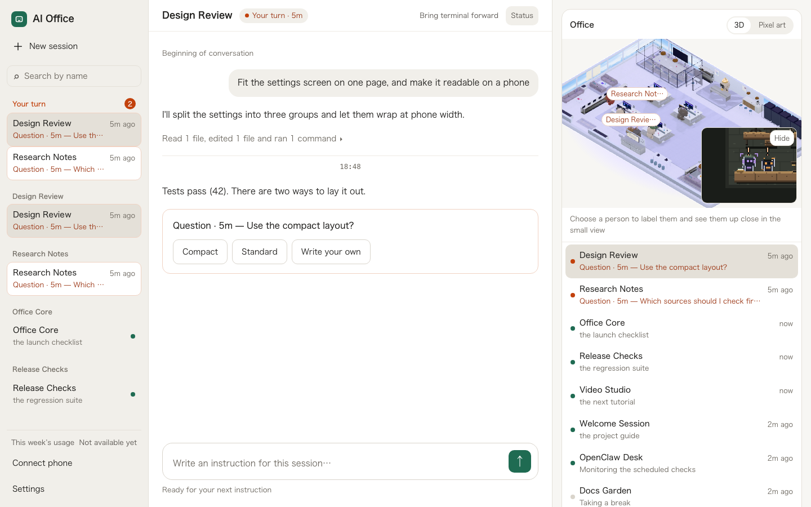

# AI Office

<!--version-->v3.0.0<!--/version--> · macOS · MIT · no account, no telemetry, no server of mine

**AI Office 3.0 puts every Claude Code, Codex CLI and OpenClaw session on your Mac — and the bots you run — into one room: see what's running, answer whatever is waiting on you from the Mac or your phone, and catch up on a day's work at a glance.**



```bash
git clone https://github.com/senao-routine/ai-office.git && cd ai-office
bash setup.sh --demo   # look first: installs nothing, Ctrl-C leaves no trace
bash setup.sh          # then put your own sessions in the room
```

Your own sessions show up from the **next** Claude Code session you open — the wiring takes effect for new sessions. To answer from your phone as well, run `bash relay/setup.sh` once; the relay lives on your own Cloudflare account ([Phone](#phone)).

## Feedback

The version is always visible in the footer. The **[Feedback]** link next to it opens the issue form and a diagnostics screen that shows you exactly what it collected — counts and states, never conversation text, folder names or project names — before you copy it yourself. The same screen lists Special Thanks for the members who tested the 3.0 betas and opted in to being named.

## What it is for

Anthropic already ships tools for *driving* your sessions: **Agent View** lists every parallel session in one place, and **Remote Control** answers them from your phone. Both are good, and AI Office is not a replacement for either. It is the other half of the problem — *seeing* a whole day's work, across more than one vendor, at a glance.

- **Every vendor in the same room.** Claude Code (interactive and background), Codex CLI and a connected OpenClaw all show up as robots on the same floor. One robot is one session; Claude Code's `/rename` becomes the name you see, so parallel sessions in the same folder stay distinguishable (project aggregation remains optional).
- **Quota and spend in one picture.** Subscription limits and metered API balances sit side by side — seven providers today, with a connection test and a "+ Connect" step, and the "no limit is set" case stated instead of a made-up percentage.
- **It never leaves your Mac.** No account, no telemetry, no server of mine. The only outbound requests are to a relay **you** deploy and to providers **you** hold keys for (see "What leaves your Mac").
- **A room worth leaving open.** Generated furniture, the time of day in the light, and robots that walk, sit, type and raise a hand when they need you — in the Cockpit's pixel art and in the 3D office alike.

## One office, four looks

The default on the Mac is a bright three-column screen (`?ui=app`). On the left: what's waiting on you, then every session, grouped by project and searchable. In the middle: the selected session's conversation the way the Claude Code app shows it — your instruction, its reply, the tools it ran folded into one line you can open, and, when it's waiting, the question with its actual options as buttons. Click one or type an instruction; it reaches the session at its next stop. On the right: the office itself — a 3D room or pixel art, with a small close-up of the person you picked — and below it what that session is doing now, its todo list and the files it changed. A resident bot gets the same treatment: pick it and the middle column shows its record (check-ins, reports, its question and your answer).

⚙ settings → **Screen** switches to three other looks of the same office. The choice is remembered per browser; the answer queue, sheets, templates, hiring and gauges are the same code in all of them.

- **The Cockpit** (`?ui=cockpit`) — a terminal-style, pixel-art office with a real terminal, the ledger and a "waiting on you" list on one screen. You can type into the terminal, Ctrl-C works, it resizes with the window, and reloading the page returns you to the same session; **"+ Terminal"** starts a new Claude Code, Codex or plain shell session in a chosen project's folder. Windows can be swapped and resized, and the terminal split into up to four panes.
- **The 3D office** (`?ui=iso`) — the daylight Scandinavian room this project started as: oak floors, white walls, plants and ceramic, rigged robots that walk, sit, type and raise a hand when they need you. Round heads with one antenna are Claude, rounded-square heads with two antennas are Codex, lobster silhouettes are OpenClaw, and box heads with a lamp on top are your bots.
- **The ledger** (`?ui=pixel`) — one row per project at thirty pixels tall, so twenty projects and forty sessions fit on one screen. A ❗ opens its session rows and moves to the top, the number keys answer it, and an evidence column says whether work actually landed (see below). Above the table runs a side-on pixel strip, drawn as a character grid in the source rather than image files, so it diffs like code.

## Working with sessions

- **Answer queue and status sheets** — actual question options, number-key replies, current/next/completed tasks, recent activity, reply chips and free-form instructions.
- **Codex CLI** — session metadata comes from read-only SQLite databases under `~/.codex`; instructions go through `codex queue`. The session adapter does not read conversation-body columns. Codex CLI must support `queue` for delivery to work; failures are reported.
- **Hire** — choose a registered project, enter a task and toggle separate-branch isolation. `POST /api/hire` starts `claude --bg`, with worktree isolation when selected. The Codex choice copies `open -a Terminal`; you run it and start Codex yourself. (In the Cockpit, "+ Terminal" can also open a live, typeable session directly on screen.)
- **Today's card** — one 1200×675 PNG of the room in pixel art and today's numbers (sessions, questions answered, commits, hours of work, tool runs), from the button at the bottom of the left column. It never contains a name: the numbers come without names and the room is drawn without text, so you can post it as is.
- **Away digest and replay** — review sessions waiting for you, finished work and ongoing work, then replay the recorded timeline in 20 seconds. This is a reconstruction from events, not a recording of terminal contents.
- **XP and levels** — completed tasks, commits, answers, timely-answer bonuses, active minutes, hires and Codex turns contribute; token usage does not. Nothing in the office is gated behind a level anymore except a café, which appears at level 20.
- **Cost gauges, notifications and reports** — quota/spend views alongside desktop notifications and daily summaries.
- **MCP** — `office_status`, `office_instruct` and `office_digest` let agents inspect the office, send instructions and read a digest. Resident bots registered under ⚙ → **Bots** get five tools of their own instead (check in, report, ask you, read your answers, withdraw); see [MCP setup](#mcp-setup-optional) below.

## Phone

The phone splits the Mac's three columns into three screens: **Conversations** (what's waiting on you, then recent sessions — open one to read its conversation and answer it), **Office** (the room, then everyone in it) and **Settings**. In the room only the person you picked and the ones waiting on you wear a name tag (four at most), so it stays readable with twenty people. A badge on the home-screen icon shows how many things are waiting on you, and it won't notify you again while you're sitting at the Mac. A session's conversation can be opened on the phone too — tool-and-result marks, diffs, a todo count — and a bot's question is answered there like any other. On a wide screen — an unfolded iPhone Duo or an iPad in landscape — the phone shows the Mac's three columns side by side instead (in portrait, the list and the conversation, with the office opening over the right column), and it always uses the Mac's light colours, even when the iPhone is in dark mode.

**Execution approval is available from the Mac's local screen (127.0.0.1) by default.** *Phone approvals* are switched on and off from the paired phone (or the Mac) with no passkey and no time limit: once on, they stay on until you turn them off in the phone's settings or on the Mac, and the Mac is notified and logs every switch. While they're on, **every request the phone can show is one tap** after a look at the summary — routine actions (tests, reads/writes inside the project, non-force git push), actions with warning tags, and dangerous ones (deleting files, force push, sending data out, changing git config or AI Office's own settings), which the card marks with a red line. Each tap is bound to the exact request and command you were shown (its ID and SHA-256), and the Mac and the hook each re-check it. What never reaches the phone is anything it can't fully read: oversized or unreadable input, a dynamic or piped-together command, downloading and running something in one step, or a tool it doesn't recognize — those stay on the Mac. If a phone's pairing secret were stolen, or the relay that serves the phone app compromised, someone could approve anything Claude asks for — dangerous actions included — while approvals are on; the mitigations are a Mac notification and audit entry for every approval and switch, instant revocation and switch-off from the Mac, and a 30-day pairing-secret expiry (extending a phone from the Mac replaces its secret and delivers the new one sealed, never in a link). You can still answer in the terminal; a terminal answer takes precedence while a hook waits. Codex uses `codex queue`; OpenClaw uses its configured inbox/relay integration.

## The evidence column

The ledger and the Cockpit both carry a column that says whether a session actually committed or passed a test in the last 24 hours — not whether it claims to have. A commit counts only when that project directory's HEAD actually moved; a test counts only when the runner's own summary line (`5 passed`, `OK`, `Tests: ... passed`, and so on) shows up in the real output, and a failing summary always wins over a passing one found elsewhere in the same output. Piping through `| tail`, running in the background, `|| true` and similar tricks don't fool it. When none of this can be determined, the column shows "—" instead of guessing.

## Stream mode

Open <http://localhost:4780/?stream=1>. This always opens the 3D office, hiding the normal HUD and leaving the office, an activity subtitle and an ❗ count. The automatic camera follows activity and stops when you take manual control.

- OBS landscape: <http://localhost:4780/?stream=1&aspect=16:9>
- Vertical video: <http://localhost:4780/?stream=1&aspect=9:16>
- Hide project names and use a one-character badge with status: add `&privacy=1`.
- Larger nameplates: add `&plates=large`.

Settings can copy URLs for OBS, vertical video or a second monitor. In browsers supporting canvas capture and MediaRecorder, settings also offer a **20-second WebM replay export**. Privacy mode changes the visible labels and subtitles; it does not change the relay's data contract.

## Quick start

**Just look first** — nothing is installed, and `Ctrl-C` leaves no trace:

```bash
git clone https://github.com/senao-routine/ai-office.git
cd ai-office
bash setup.sh --demo
```

**Then, when you want your own sessions in the room:**

```bash
bash setup.sh
```

`setup.sh` installs the hooks, registers the resident app and starts it with `launchctl`, checks that the server responds, and opens the office. Re-running it is safe. Its optional first-session walkthrough defaults to No.

```bash
bash setup.sh --check       # diagnose only
bash setup.sh --no-daemon   # run here without installing the resident app
```

Open <http://localhost:4780>. Local sessions appear as robots; use `/?demo=1` to explore without sessions.

### MCP setup (optional)

```bash
claude mcp add --scope user aioffice -- "$(command -v python3)" "$PWD/server/mcp_office.py"
claude mcp list
```

Resident bots and scripts can also take a seat of their own and ask you questions (the *door* — [contract](docs/door.md)). Register them on the Mac under ⚙ settings → **Bots**: the panel lists each bot (last activity, open question, unread items, mute), and **Copy the register command** gives the one line to run in that bot's own work folder — `claude mcp add aioffice-door-<id> -- <python3> <…>/server/mcp_office.py --bot <id>` (deliberately not `--scope user`, so ordinary sessions don't get the bot's tools). Muting a bot silences the Mac's sounds and notifications for its questions; it still shows in the lists, and the phone still notifies. Registering, muting and deleting work only from the Mac's own screen (or `python3 server/office_door.py add <id> --name …` in a terminal), never from the phone or through a bot's tools.

### Setting up the phone (optional)

The relay runs on **your own Cloudflare account**. The Mac connects outbound; no inbound port forwarding is needed.

```bash
bash relay/setup.sh
```

The setup script handles Cloudflare login, token/push-key generation, deployment, local relay configuration and connectivity checks. Then open **Phone pairing** in the office, issue a device and open the link on your phone. On iPhone, add it to the Home Screen and enable push. Node.js is needed for the relay setup; see [the relay guide](relay/README.md).

The relay uses an allow-list. It carries status, questions/options, chosen session titles, background summaries, templates and scrubbed action results; transcript bodies and local path fields are removed on the Mac. The one deliberate exception is resident bots: a bot's status line and its question (with options), and your answers and instructions to that bot, travel through your relay as plain text so you can answer a bot from the phone. A Mac session's text and paths never do. Titles and background summaries can be disabled separately. See [the exact data contract](docs/office-json.md). Instructions are signed per device and verified on the Mac; the relay's transport token cannot forge them.

**Showing the terminal screen on the phone is off by default.** Turn on *Show conversations on the phone* and the phone's terminal view can show instructions, replies, command output and diffs (off, you get only a one-line summary). The Mac seals it with **AES-256-GCM using a key derived for that one device** and hands the ciphertext to the relay, so the relay only ever holds ciphertext. What this doesn't protect: the relay still sees *when* a device asked for *which* session and roughly how large the reply was; there is no forward secrecy (the pairing secret stays the same until it expires or you extend the phone from the Mac, which replaces it); the ciphertext itself expires on the relay after 90 seconds; and **if you lose the phone, whoever has it can read terminal screens as well as send instructions** — revoking the device from the Mac stops new envelopes immediately. Macs where the system crypto library is unavailable simply don't offer the toggle.

### What it touches

- `~/.claude/settings.json` — hook wiring, with a backup: **Stop** for instruction delivery, **PermissionRequest** for pending approvals/questions, and asynchronous recording across **17 event types**. Existing unrelated hooks are kept.
- `hooks/office-event.sh` — the recording hook's repository source, copied to `~/.claude/hooks/office-event.sh`. It records event types, identifiers, counts and limited metadata such as basenames; **it never writes prompt, command or response bodies**. Records go to `~/.claude/office_events/<YYYY-MM-DD>.jsonl`.
- `~/.claude/office_timeline.sqlite` — the local timeline database used for the digest, replay, XP and the evidence column. It stores events and state/wait intervals, with no conversation-body columns. `~/.claude/office_seen.json` records when you last acknowledged the digest.
- `~/.claude/office_inbox/` and `~/.claude/office_approvals/` — instruction delivery and pending permission requests/answers; these can contain the text needed to answer a session and are separate from the body-free event log.
- `~/.claude/office_recipes.json`, `~/.claude/office_action_results.json` and `~/.claude/office_actions_audit.jsonl` (all `0600`) — the allow-list of actions you can run from your phone, their most recent outcomes, and an audit trail. The stored outcome carries the label, state and scrubbed output only — never the command line, working directory or environment.
- `~/.claude/office_approve_keys.json`, `~/.claude/office_remote_approve.json` and `~/.claude/office_approvals_audit.jsonl` (all `0600`) — phone passkeys registered by older versions (no longer created), whether phone approval is currently on, and an audit trail of every switch and approval, so the Mac can show and revoke what's been granted.
- `~/.claude/projects/` — Claude transcripts are read-only. The Codex session adapter reads metadata from `~/.codex/state_5.sqlite` and `~/.codex/thread_history_1.sqlite` read-only; it does not modify those databases. The Cockpit's real terminal keeps its own output only in memory, never on disk.
- `~/Library/Application Support/AIOffice/` — the installed app and its data.
- `~/Library/LaunchAgents/com.senao.aioffice.plist` — starts the office at login.
- macOS may ask for Automation permission when the office opens Terminal, and for notification permission.

### What leaves your Mac

Nothing is sent to me. There is no account, no telemetry, and no server of mine: the repository contains no endpoint I control, and the app does not even check for updates on start-up. The HTTP server binds `127.0.0.1` only, so it is not reachable from your LAN.

Exactly two kinds of outbound request exist, and you switch both on yourself:

| Destination | When | What is sent |
|---|---|---|
| **The Cloudflare Worker you deploy** (`relay/`) | Only if you set up the phone relay | The office view on an allowlist — no message bodies from your sessions, no local paths. The one exception: a resident bot's status line and question, and your answers to it (so you can answer a bot from the phone). New fields are excluded by default. |
| **api.anthropic.com · api.openai.com · api.mistral.ai · openrouter.ai · api.moonshot.ai · api.deepseek.com · api.groq.com · api.x.com** | Only for a provider whose API key you entered, or when you run its connection test | A `GET` with your key, to read your own spend/balance/quota or confirm the key works. Nothing about your office is included, and with no key stored not a single byte is sent. Results are cached for 15 minutes. |

The browser side loads nothing from the internet: no CDN, no web fonts, no analytics. three.js and xterm.js are vendored in this repository.

## Pricing

**All features are free.** The local office, phone PWA, push, configured remote actions, cost dashboard and stream mode are included. There are no editions, licenses or AI Office subscriptions. AI-provider and Cloudflare usage follow your own accounts' plans.

Updates and the Routine Labo community are on the [product page](https://routinelabo-lp.routinelabo-senao.workers.dev).

## Requirements

| | |
|---|---|
| **Mac** | Apple Silicon or Intel. macOS 13 Ventura or newer (tested on 15 Sequoia). |
| **Python** | The stock `/usr/bin/python3` (3.9.6) is enough — the server uses the standard library only. Xcode Command Line Tools provide it: `xcode-select --install`. |
| **Agents** | Claude Code (interactive and background), Codex CLI, or a configured OpenClaw connection. Hiring needs Claude Code with background sessions; delivery to Codex needs `codex queue`. Answering permission prompts from the office needs a Claude Code build with `PermissionRequest` hooks. |
| **Browser** | The default screen, the Cockpit and the ledger are plain HTML and 2D canvas — any modern browser works. The 3D views need WebGL: without it the 3D office falls back to a list, and the default screen's room can be switched to pixel art. |
| **Node.js** | Only for development checks and the optional phone relay (wrangler needs Node 22+). Running the local office needs no package install. |
| **Language** | English/Japanese, auto-detected. Pin `"lang"` in `office_config.json`. |

**Not supported:** Windows and Linux. The resident app, the Terminal integration and the sealed-dialog backend are macOS-specific.

## Uninstalling

Stop the daemons first — `uninstall.sh` deliberately does not run `launchctl` for you (unregistering a login item is your call), so it stops and tells you what to run if either label is still registered:

```bash
launchctl bootout gui/$(id -u)/com.senao.aioffice
launchctl bootout gui/$(id -u)/com.senao.aioffice.relay   # if you enabled phone delivery

bash macapp/uninstall.sh              # remove the plists and code; keep data/config
bash macapp/uninstall.sh --purge-data # also remove app data/config
```

The hook wiring in `~/.claude/settings.json` is not removed automatically. Remove the AI Office entries referencing `office-inbox-wait`, `office-approval-wait` and `office-event`, or restore the settings backup. The event-recording entries span multiple event types. Local event/timeline files under `~/.claude` are separate from the app's data directory.

## Documentation

[日本語](README.ja.md) · [Changelog](CHANGELOG.md) · [Art direction](docs/art-direction.md) · [Office JSON](docs/office-json.md)

## Support

Run `bash setup.sh --check` first — it diagnoses the things that break most often and its output is what a bug report needs. Then open an [issue](https://github.com/senao-routine/ai-office/issues) (English or Japanese). For anything security-related, use GitHub's private vulnerability reporting instead of a public issue; see [SECURITY.md](.github/SECURITY.md).

This is a one-person project, so I cannot promise a response time — but I read everything.

Built by [senao](https://github.com/senao-routine) / Routine Labo.
